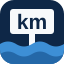

<p align="center"></p>

<h1 align="center">FlussKM – Flusskilometer &amp; Pegel</h1>

Karten-Web-App, die zu einem **Flusskilometer** die genaue Position findet und die **aktuellen Wasserstände** aller Pegel im Kartenausschnitt zeigt. Sie besteht aus einer einzigen HTML-Datei, braucht keinen Build-Schritt und keinen Server und läuft auf Desktop, Tablet und Handy.

## Funktionen

- **Kilometersuche** für Rhein, Elbe, Donau, Weser, Main, Mosel, Neckar, Saale und Oder (weitere Gewässer lassen sich in `DEFAULT_RIVERS` in `index.html` ergänzen)
  - Nutzt Kilometermarken aus OpenStreetMap/OpenSeaMap (`seamark:type=distance_mark`, `waterway=milestone`)
  - Zwischenwerte wie `325,4` werden zwischen benachbarten Marken interpoliert. Liegen Marken an beiden Ufern, zeigt die App die Mitte zwischen ihnen.
  - **Plausibilisierung über PEGELONLINE:** Aus der Kilometrierung der Pegel wird eine erwartete Position berechnet. So werden gleich nummerierte Marken anderer Gewässer (z. B. Kanäle oder Nebenflüsse mit eigener Kilometrierung) nachrangig einsortiert und als „weitere Treffer“ angeboten.
  - Die Schätzung aus den Pegeln erscheint **sofort als vorläufiges Ergebnis** und wird ersetzt, sobald die OSM-Marken geladen sind. Ist Overpass nicht erreichbar, bleibt sie als klar gekennzeichnete Schätzung stehen.
  - Koordinaten in vier Formaten (Zeile antippen kopiert sie), Links zu OSM, Google Maps und Apple Karten, die nächsten Pegel mit aktuellem Wasserstand
- **Positionsmarker** setzen: über den Marker-Button (dann auf die Karte tippen), per Rechtsklick oder durch langes Tippen auf Touch-Geräten
  - Der Marker ist verschiebbar und zeigt seine Position in vier Formaten, jede Zeile wird beim Antippen kopiert (dazu „Alle kopieren“ und Links zu OSM, Google Maps und Apple Karten):

    | Format | Beispiel |
    |---|---|
    | GPS (Nord/Ost, Grad und Dezimalminuten) | `N 50° 21.414' E 007° 36.378'` |
    | WGS84 (dezimal) | `50.356900, 7.606300` |
    | UTM | `32U 400860 5579242` |
    | UTMREF (MGRS) | `32U MA 00860 79242` |

  - Die Umrechnung nach UTM und UTMREF ist eingebaut, ohne Zusatzbibliothek. Sie stimmt mit PROJ auf Sub-Millimeter überein und beachtet die Sonderzonen für Norwegen und Spitzbergen. UTM und UTMREF werden nach Norm auf volle Meter abgeschnitten, nicht gerundet.
  - Die Markerposition steht in der URL (`?marker=50.3569,7.6063`), der Link lässt sich also teilen.
  - Auch Ergebnisse der Kilometersuche zeigen alle vier Formate.
- **Strecke messen** über das Lineal-Symbol: Punkte setzen, ziehen und zurücknehmen. Angezeigt werden die Gesamtstrecke, der letzte Abschnitt und an jedem Punkt die aufsummierte Distanz. Gerechnet wird geodätisch auf dem WGS84-Ellipsoid (Vincenty); das Ergebnis stimmt mit PROJ überein.
- **Marker löschen:** Positionsmarker, Treffer-Marker und Messpunkte lassen sich über ihr Popup bzw. die Messleiste wieder entfernen.
- **Ortssuche** über Nominatim, mit Trefferliste
  - Zeigt die **Grenze der Gebietskörperschaft** an (Gemeinde, Stadt, Landkreis, Bundesland …). Bei Ortsteilen, Adressen oder Gebäuden wird die Gemeinde bestimmt, in der sie liegen, und deren Grenze gezeigt. Die Grenze lässt sich im Ort-Reiter oder im Layer-Menü aus- und wieder einblenden, ohne neu zu suchen.
- **Pegelstationen im Sichtbereich** (PEGELONLINE, live)
  - Farbe nach Status: über HSW, über MHW, Normalbereich, unter MNW, ohne Einstufung, veraltet
  - Ab Zoomstufe 10 stehen die Wasserstände direkt an der Karte
  - Popup mit Messwert, Alter der Messung, Höhe über NHN, Trend (cm/h) und Ganglinie der letzten 24 h
  - **Wassertemperatur**, sofern der Pegel sie misst (rund 120 Stationen): in der Liste, an der Karte und im Popup. Ältere Werte als 6 h erscheinen nur im Popup, mit Datum und dem Vermerk „veraltet“. Die Werte sind ungeprüfte Rohdaten, einzelne Stationen melden offensichtliche Fehlwerte.
  - Liste der Pegel im Ausschnitt, automatische Aktualisierung (Standard: alle 5 min)
- **Gesten wie in gängigen Karten-Apps** (Tablet/Handy): ziehen, mit zwei Fingern zoomen und drehen, doppelt tippen zum Hineinzoomen, mit zwei Fingern tippen zum Herauszoomen, doppelt tippen und ziehen zum stufenlosen Zoomen. Am Desktop dreht man mit gedrückter rechter Maustaste. Kleine Drehungen rasten auf Norden ein.
- **Einnorden:** Der Kompass rechts zeigt die aktuelle Drehung und ist hervorgehoben, sobald die Karte nicht genordet ist. Ein Tipp stellt Norden wieder nach oben.
- **Kartenlayer:** Nacht (CARTO Dark Matter), Standard (CARTO Voyager), Hell (CARTO Positron), Kontrast (Positron, kontrastverstärkt), OSM. Dazu lassen sich die Seezeichen (OpenSeaMap) und die Pegel ein- und ausblenden.
- **Touch-tauglich:** Auf dem Handy wird das Panel zum Bottom Sheet. Alle Schaltflächen sind mindestens 44 px groß, und es gibt eine Standort-Funktion.

## Start

Einfach `index.html` im Browser öffnen. Die App lädt alle Daten aus dem Internet.

Für die Standort-Funktion (GPS) braucht der Browser eine sichere Verbindung, also `https://` oder `localhost`. Lokal geht das zum Beispiel so:

```sh
python3 -m http.server 8000
# → http://localhost:8000/
```

Auf GitHub Pages lässt sich das Repository ohne Anpassungen veröffentlichen.

## App-Icon

`icon.svg` dient als Favicon und erscheint in der README. Für den Startbildschirm unter iOS und Android liegen PNG-Icons in `icons/`, die `manifest.webmanifest` einbindet; die App lässt sich so über „Zum Home-Bildschirm“ installieren. Fehlen die Icon-Dateien, funktioniert die App trotzdem.

## Startort pro Gerät

Es gibt keine Konfigurationsdatei. Über das Zahnrad im Panel öffnet sich das Einstellungsfenster. Dort lässt sich der Start **für das jeweilige Gerät** festlegen: Fluss, Stadt, optional ein Kilometer und der Kartenlayer. Die Einstellung wird im `localStorage` des Browsers gespeichert. Ein Cookie wäre ungeeignet, weil Safari per JavaScript gesetzte Cookies nach spätestens 7 Tagen löscht und Browser unter `file://` oft gar keine Cookies speichern.

- Ein **neues Gerät** startet mit der Deutschlandansicht und bietet einmalig an, einen eigenen Startort festzulegen („Vorgabe behalten“ blendet den Hinweis dauerhaft aus).
- Rangfolge: **URL-Parameter → Einstellung des Geräts → Deutschlandansicht**.
- Die Einstellung gilt pro Browser. Im privaten Modus oder nach dem Löschen der Websitedaten ist sie weg. Safari kann den Speicher von Websites leeren, die 7 Tage lang nicht geöffnet wurden; als Home-Bildschirm-App ist sie davon ausgenommen.

**Was beim Öffnen passiert:**

| Einstellung | Startansicht |
|---|---|
| `?marker=…` in der URL | zeigt den geteilten Marker (hat Vorrang) |
| Fluss + Kilometer gespeichert | springt direkt zum Flusskilometer |
| Stadt gespeichert | zoomt auf die Stadt und zeigt ihre Grenze, der Fluss ist vorausgewählt |
| nur Fluss gespeichert | zeigt den ganzen Fluss |
| nichts | Deutschlandansicht |

Die Suchmasken bleiben in jedem Fall nutzbar.

**URL-Parameter** haben Vorrang vor der Geräte-Einstellung. Nach jeder Kilometersuche wird die URL aktualisiert, so dass man den Link direkt teilen kann:

```
index.html?fluss=Rhein&km=500
index.html?ort=Koblenz&karte=nacht
index.html?marker=50.3569,7.6063
```

## Datenquellen

| Daten | Quelle | Lizenz |
|---|---|---|
| Kilometermarken | [OpenStreetMap](https://www.openstreetmap.org) über die [Overpass API](https://overpass-api.de) | ODbL |
| Pegel / Wasserstände | [PEGELONLINE](https://www.pegelonline.wsv.de) (WSV) | DL-DE/Zero-2.0 |
| Basiskarten | [CARTO](https://carto.com/basemaps), [OpenStreetMap](https://www.openstreetmap.org) | ODbL / CARTO-Bedingungen |
| Seezeichen | [OpenSeaMap](https://www.openseamap.org) | CC BY-SA |
| Ortssuche | [Nominatim](https://nominatim.org) | ODbL |
| Kartenbibliothek | [MapLibre GL JS](https://maplibre.org) 4.7.1 | BSD-3 |

Die öffentlichen Dienste (Overpass, Nominatim, OSM-Kacheln) haben Nutzungsrichtlinien und sind für gelegentliche, interaktive Nutzung gedacht. Für den Dauerbetrieb, etwa als Kiosk, sollten eigene oder kommerzielle Endpunkte genutzt werden (Liste `overpassServer` in `index.html`). Die öffentlichen Overpass-Server sind zeitweise überlastet. Die App fragt die Server parallel und wartet höchstens 75 s; bis dahin ist die vorläufige Position aus den Pegeln zu sehen, danach lässt sich die Suche erneut starten.

## Hinweise zur Genauigkeit

- Kilometermarken in OSM sind von Freiwilligen erfasst. Ihre Abdeckung ist je nach Fluss unterschiedlich.
- Eine Schätzung aus den Pegeln ist eine **Luftlinien-Interpolation** zwischen zwei Pegeln. In Flussschleifen kann sie mehrere hundert Meter bis Kilometer danebenliegen.
- Unterweser und Mittel-/Oberweser werden getrennt kilometriert. Die App erkennt solche Doppelungen und zeigt dann mehrere Treffer.
- Die App ersetzt keine amtlichen Informationen. Für Einsätze gelten die Angaben der WSV und der zuständigen Stellen.
